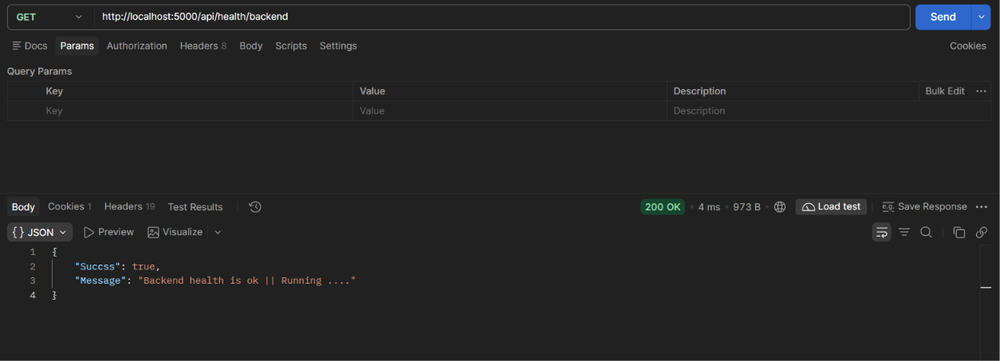

# File storage backend !

## phase 1 : foundation & project Setup

**Backend Tech Stack ->**

**Node + express** _-> HTTP server, REST APIs, middleware, validation and authorization._

**mysql** _-> Stores file metadata, users, folders, ownership and permissions._

**minIo + docker** _-> Stores the actual file contents as objects, separately from the metadata database._

## — Initialize the Node.js project

```sh

mkdir Backend

cd Backend

npm init -y

```

## Folders setup ->

```sh

mkdir Src

cd Src

mkdir config  routes controllers services queries middlewares utils dist

```

- #### routes: Define endpoints and connect them to handlers.

- #### controllers: Handle HTTP requests and responses.

- #### services: Implement business rules, such as validating ownership or coordinating storage operations.

- #### queries: Contain MySQL query functions.

- #### c onfig: Configure connections to MySQL and MinIO.

- #### middleware: Handle cross-cutting concerns such as authentication, validation and error handling.

- #### types :  Shared TypeScript types aur interfaces

- #### dist :  Compiled JavaScript output

- #### server :  backend server files here 

## npm type change ->

```sh

npm pkg set type=module

```

## Install dependencies

```sh
npm install express dotenv cors helmet mysql2 multer @aws-sdk/client-s3 @aws-sdk/s3-request-presigner

npm install -D nodemon

```

#### -------Package ----------------||-----------------Purpose-------------------
- express                        ||  Creates the HTTP server and REST API routes.
- dotenv                         ||  Loads local environment variables from .env.
- cors                           ||  Controls which browser origins can call your API.
- helmet                         || Sets useful HTTP security headers.
- @aws-sdk/client-s3             || Communicates with MinIO through its S3-compatible API.
- @aws-sdk/s3-request-presigner  || Generates presigned URLs for temporary, controlled object access.
- nodemon                        ||  Restarts the development server when files change.
---

## Install Typescript 
```sh 
▶ npm i --save-dev typescript tsx @types/node @types/express @types/cors

npx tsc --init 
```

## setup folder for typescript complied code 
- open tsconfig.json 

```json
{ 
       // File Layout
    "rootDir": "./Src",
    "outDir": "./Src/dist/",
}
```

## npm scripts 

```json 
  "scripts": {
    "ts-build": "npx tsc --watch",
    "server" : "nodemon -L Src/dist/server/server.js"
  },
```

```sh
npm run 

```

## setup backend server -> 
- app.ts 
```ts 

import express, {type Request, type Response} from "express"
import cors from "cors"
import helmet from "helmet"
import getHealthRouter from "../routes/Health.routes.js"

const app = express()  // create app 

app.use(helmet())
app.use(cors())
app.use(express.json({
    limit : "10mb"
}))


// Routing ->> 
app.use('/api/health',getHealthRouter)


export default app

```
- server.ts

```ts 
import app from "./app.js";

// port 
const port = Number(process.env.Port)  || 5000 ; 

app.listen(port,()=>{
    console.log(`Server Running http://localhost:${port}`);
})
```
- gethealth controller code 

```ts 

import { Router } from "express";
import { getHealth } from "../controllers/GetHealth.controller.js";


const getHealthRouter = Router(); 

getHealthRouter.get('/backend',getHealth)


export default getHealthRouter
```

- gethealth router code 

```ts 
import { Router } from "express";
import { getHealth } from "../controllers/GetHealth.controller.js";


const getHealthRouter = Router(); 

getHealthRouter.get('/backend',getHealth)


export default getHealthRouter
```

## Run server -> 

1) terminal 
```sh 
npm run ts-build
```

2) terminal
```sh 
npm run server
```

## lets test backend health api !!
- IN postman 




-------- 