# Task Management REST API

A RESTful backend API for managing projects, project members, tasks, and comments. The application supports authentication, authorization, and task filtering.

## Features

* User authentication and JWT-based authorization
* Role-based access control (RBAC)
* Project CRUD operations
* Project member management
* Task CRUD operations
* Project comments management
* Pagination, filtering, sorting, and search
* Centralized error handling
* MySQL database integration


## Tech Stack

* **Runtime:** Node.js
* **Framework:** Express.js
* **Database:** MySQL
* **Database Driver:** mysql2
* **Authentication:** JWT
* **API Style:** REST API
* **Database Environment:** Docker

---- 

## Installation and Setup

### 1. Clone the repository

```bash
git clone YOUR_REPOSITORY_URL // need to paste after finising other things 
cd YOUR_PROJECT_FOLDER
```

### 2. Install dependencies

```bash
npm install
```

### 3. Configure environment variables

Create a `.env` file in the project root and configure the required variables.

### 4. Start the application

```bash
npm run dev
```

Use the start command defined in your `package.json`.


## Environment Variables

Configure the following variables in your `.env` file.

| Variable      | Description         |
| ------------- | ------------------- |
| `PORT`        | Backend server port |
| `DB_HOST`     | MySQL host          |
| `DB_PORT`     | MySQL port          |
| `DB_USER`     | MySQL username      |
| `DB_PASSWORD` | MySQL password      |
| `DB_NAME`     | Database name       |
| `JWT_SECRET`  | JWT signing secret  |

Variable names should match the application's actual configuration.
- or ham apne hisab se kuch bhi naming kr skte hain variables ki !! 

--- 

## How to Start Project -> 
 
 - open project folder in vscode ! 
```sh 


code projectFOldername

```

 - ### Start docker database first 
```sh 

docker start yourdockercontainer-mysql

## im using ubuntu+mysql 

docker start ubuntu-mysql 

docker exec -it ubuntu-mysql bash 

## now in ubuntu we need to start mysql  !! 

$/> mysqld --user=mysql &  ## start mysql service in background 

$/> mysql  

```
 - now Start backend server now 


## API Endpoints ->

### Health api route -> 
* `GET /api/health` — api health check route 

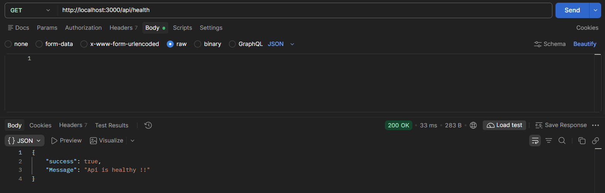


### Authentication / user create / login 

* `POST /api/signup` — Register a user

```json
// need to signup -> 
"userId" : number, 
"username" : string, 
"email" : string,
"password" : string,
"role"  : string (user|admin)

```

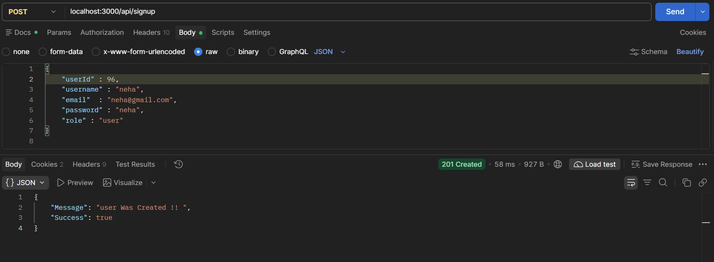

 ### check ->> 
  - hame duplicate users create nhi kr skte !! 

 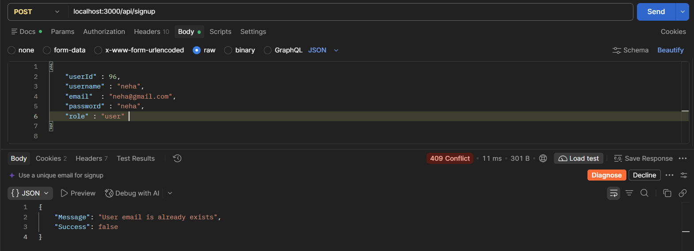 

--- 
*** 

* `POST /api/auth/login` — Authenticate a user

```json 
"userId" : number,
"email" : string,
"password" : string

```

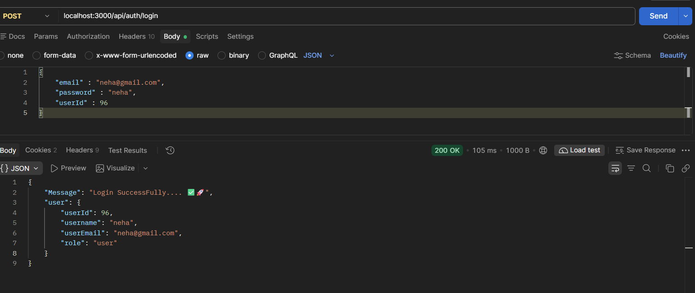

### Projects

* `POST /api/projects` — Create a project
```json 
"projectName" : string,
"desccription" : string,
"projectStatus" : string ('onGoing' 'completed','canceled')

```
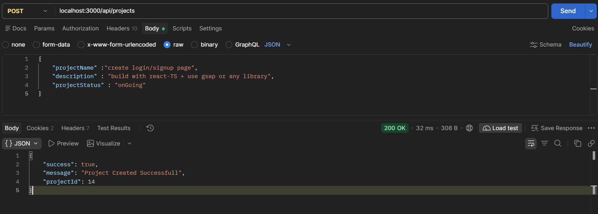


* `GET /api/projects` — Get projects
  - **NOTE** - *har user apne private projects create krta hai koi other user kisi or user k projects nhi get kr skta so ager projects nhi get ho rahe means ko bhi projects nhi hai !! or jo hai vo uss user k he honge !!*

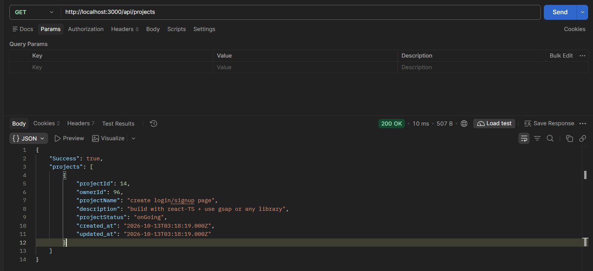

---- 

* `GET /api/projects/projectId` — Get project by projectid
  - `GET /api/projects/14` 

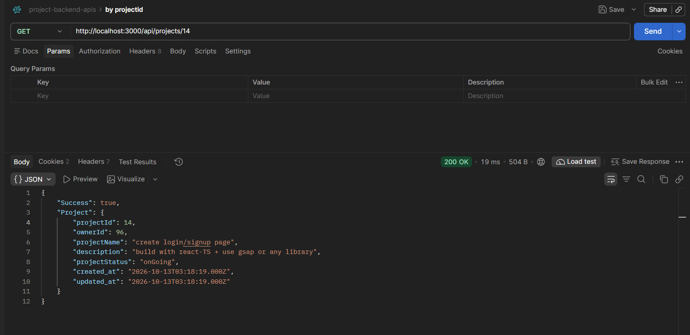

 
 - ### if mere pass do users hai let check something ! 
  - User : neha  ✅ logged already 
  - User : admin  ✅ login now -> 

  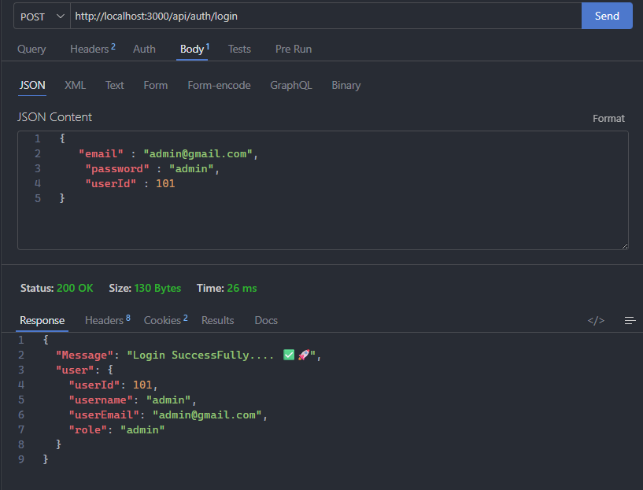

 - dono k pass apne apne projects hai ! 

 ###  - User : neha  


 
 ###  - User : admin

 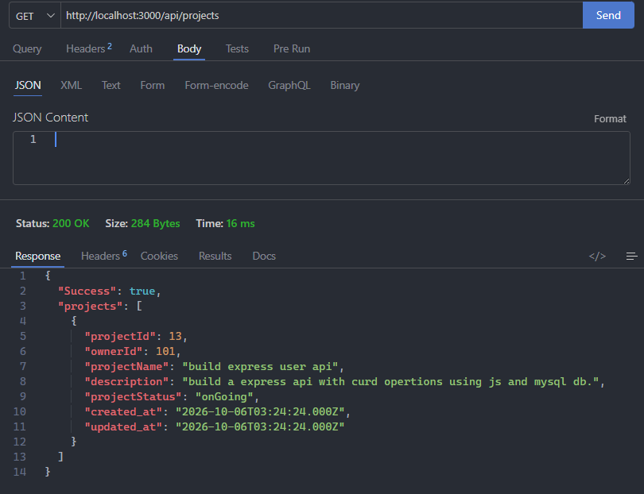  

 - dono he ek dusre k projects nhi dekh skte let test !! 
 ###  - User : neha  
 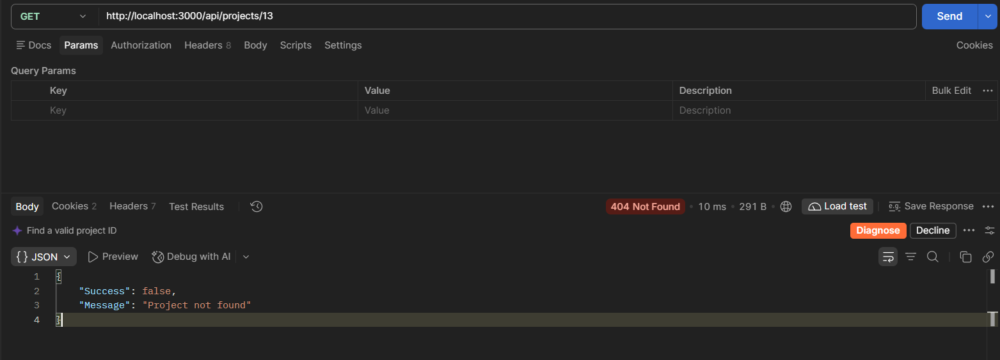

 ###  - User : admin
 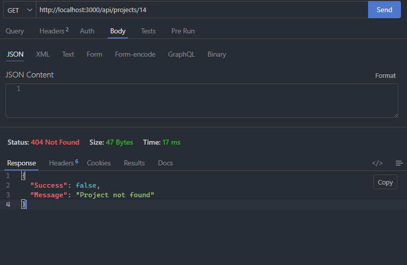

 - *See dono he ek dusre k projects ko get nhi kr skte !!*

### ProjectMembers 
* `POST /api/projects/projectId/members` — add project members

```json 
{
  "memberId" : 96,
  "role" : "member"
}

```
- NOTE -> user(member) must be exists in users !! means vesa koi user exist bhi krta hona chaahie...
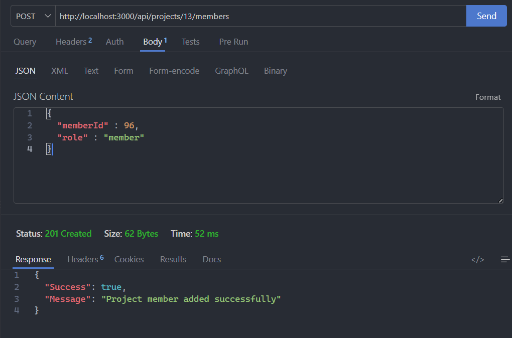

- NOTE little update in get project by id -> Ager Request krne vala user project owner nhi ho to member hona chaahie !  ager member hai to jis project ka member hai uski detail milgi -> lets test -> 

- ### user : neha userId -> 96
 - hamne ese project 13 ka member banaya hai 
* `GET /api/projects/projectId/members` — get all project members

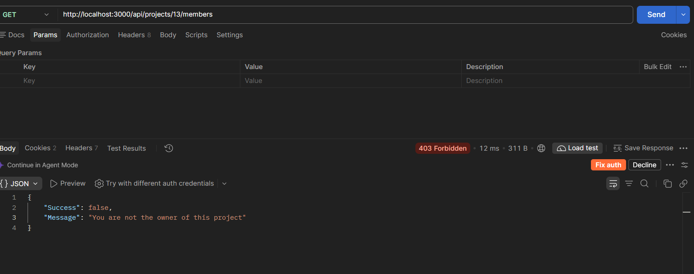
 - see means neha es project ki owner nhi hai ok or vo members nhi dekh skti es project mein !! but vo apne project k memebers ko dekh skti hai 

 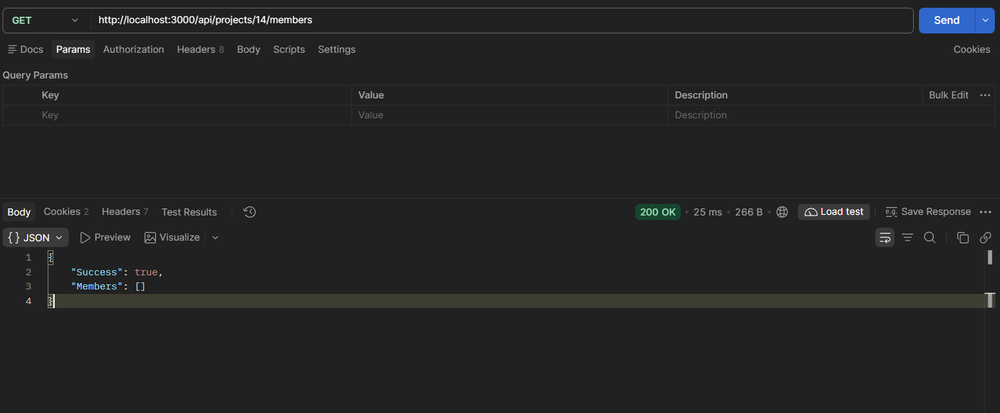
 - keoki usne koi members add nhi kre apne project mein !! 

- ### NOTE *neha admin k project 13 ki member hai !! to lets check admin project13 members ->*

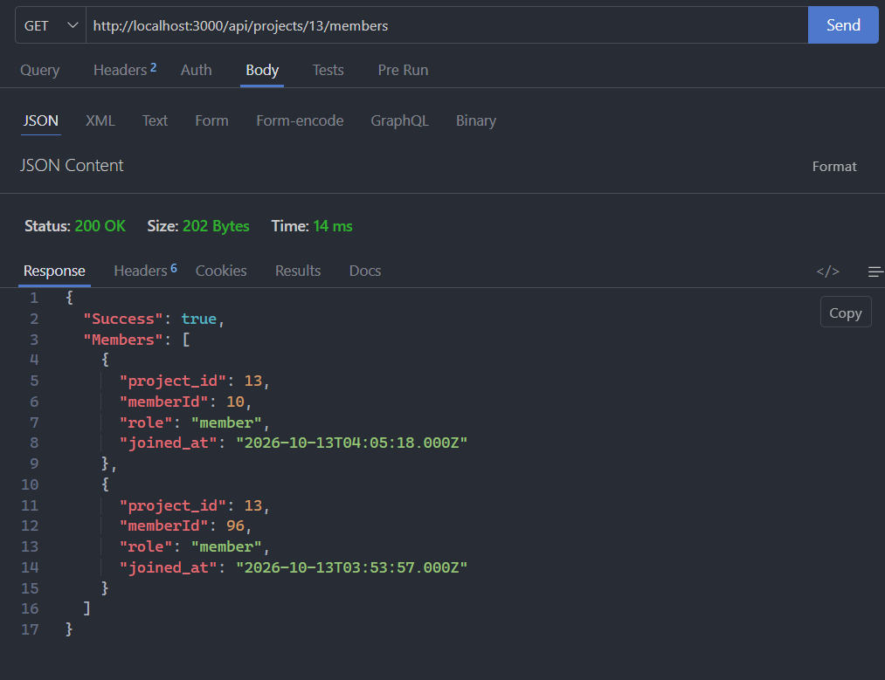

- ### Now neha project 13 ki member hai to use project13  ki detail milni chaahie !! -> 
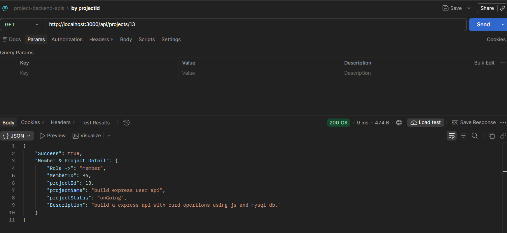

### Tasks

* `GET /api/tasks` — Get tasks
* `POST /api/tasks` — Create a task

### Comments

* Add your implemented comment routes here.

**Note:** Replace these example paths with the exact routes implemented in the application.
